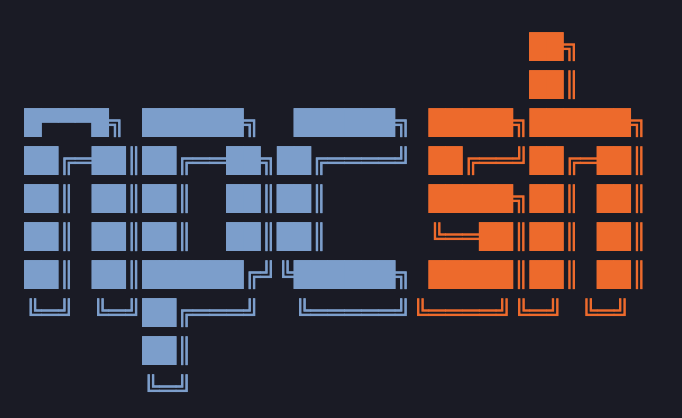

<p align="center">
  <a href="https://github.com/npc-worldwide/npcsh/blob/main/docs/index.md">
  </a>
</p>

<h1 align="center">npcsh</h1>

<p align="center">
  <strong>The composable multi-agent shell for seamless command-line experiences.</strong>
</p>

<p align="center">
  <a href="https://github.com/npc-worldwide/npcsh/blob/main/LICENSE"></a>
  <a href="https://crates.io/crates/npcsh"></a>
  <a href="https://npc-shell.readthedocs.io/"></a>
</p>

---

`npcsh` interprets bash and natural language seamlessly within a single interface, making the most of LLMs and agents through an interactive shell. Engineer context and design custom Jinja Execution templates (Jinxes) for your agents to invoke for tool-use, prompts, and skills.

Install `npcsh`:

```bash
curl -fsSL https://enpisi.com/install-npcsh.sh | sh
npcsh
```

Ask a question:
```bash
npcsh> what process is listening on port 5337?
```

Delegate to a coding agent:
```bash
npcsh> @corca refactor the auth module and add tests
```

Open the Git TUI after changes:
```bash
npcsh> /git
```

---

## Benchmark Results

The benchmark suite measures how well a model can drive `npcsh` as an agentic shell. It covers 100 tasks across 10 categories, from basic shell commands and file operations to multi-step workflows, debugging, git, and scripting. Each task is scored pass/fail by an automated verifier.

The table below shows scores (100 tasks).

### Scores (100 tasks)

| Maker | Family | Model | Params | Version | Score |
| --- | --- | --- | --- | --- | --- |
| Alibaba | Qwen | 3.5 | 0.8b | v2.1.25 | 59/100 (59%) |
| Alibaba | Qwen | 3.5 | 2b | v2.1.25 | 86/100 (86%) |
| Alibaba | Qwen | 3.5 | 4b | v2.1.25 | 96/100 (96%) |
| Alibaba | Qwen | 3.5 | 9b | v2.1.25 | 91/100 (91%) |
| Alibaba | Qwen | 3.5 | 35b | v2.1.5 | 97/100 (97%) |
| Alibaba | Qwen | 3.5 | 397b | v2.1.7 | 96/100 (96%) |
| Alibaba | Qwen | 3.6 | 35b | v2.1.5 | 91/100 (91%) |
| Alibaba | Qwen | 3.8 | 27b | v2.1.25 | 97/100 (97%) |
| Alibaba | Qwen | 3 | 0.6b | v2.1.25 | 15/100 (15%) |
| Alibaba | Qwen | 3 | 1.7b | v2.1.25 | 43/100 (43%) |
| Ornith | - | - | 9b | v2.1.5 | 57/100 (57%) |
| Ornith | - | - | 35b | v2.1.7 | 97/100 (97%) |
| Moonshot AI | Kimi | K2.7-Code | 1t (32b active) | v2.1.7 | 97/100 (97%) |
| Minimax | - | M3 | 428b (23b active) | v2.1.7 | 96/100 (96%) |
| DeepSeek | - | V4 Flash | 284b (13b active) | v2.1.7 | 95/100 (95%) |
| Mistral AI | - | Devstral Small 2 | 24b | v2.1.7 | 94/100 (94%) |
| Mistral AI | - | Devstral 2 | 123b | v2.1.7 | 94/100 (94%) |
| Mistral AI | - | Large 3 | 675b | v2.1.7 | 89/100 (89%) |
| North AI Labs | - | Mini Code 1.0 | 30b (3b active) | v2.1.5 | 93/100 (93%) |
| Google | Gemma | 4 | 2b (e2b) | v2.1.25 | 90/100 (90%) |
| Google | Gemma | 4 | 4b (e4b) | v2.1.25 | 88/100 (88%) |
| Google | Gemma | 4 | 4b (e4b) | v2.1.7 | 96/100 (96%) |
| Google | Gemma | 4 | 26b | v2.1.7 | 96/100 (96%) |
| Google | Gemma | 4 | 31b | v2.1.7 | 92/100 (92%) |
| IBM | Granite | 4.1 | 3b | v2.1.25 | 81/100 (81%) |
| IBM | Granite | 4.1 | 8b | v2.1.7 | 81/100 (81%) |
| IBM | Granite | 4.1 | 30b | v2.1.7 | 94/100 (94%) |
| Meta | Llama | 3.2 | 3b | v2.1.25 | 16/100 (16%) |
| Meta | Llama | 3.2 | 8b | v2.1.25 | 23/100 (23%) |
| Prism ML | Bonsai | 2 | 9b | v2.1.25 | 96/100 (96%) |
| Xiaomi | MiMo | 2.6 | 9.4b | v2.1.25 | 95/100 (95%) |
| Liquid AI | LFM | 3 | 1.7b | v2.1.25 | 87/100 (87%) |
| Thinking Machines Lab | Inkling | 2 Small | 594b total / 17b active | v2.1.25 | 97/100 (97%) |
| Reflection AI | Beam | - | 501b total / 23b active | v2.1.25 | 94/100 (94%) |
| Muse | Spark | Open | 816b total / 42b active | v2.1.25 | 98/100 (98%) |
| Zhipu AI | GLM | 4.7 Flash | 32b | v2.1.25 | 91/100 (91%) |

For a more comprehensive view of npcsh's capabilities and the NPC Context-Agent-Tool data layer, see [ALARA for Agents: Least-Privilege Context Engineering Through Portable Composable Multi-Agent Teams](https://arxiv.org/abs/2603.20380).  

To view traces from benchmark runs for the above models, check out [npcsh-traces](https://hf.co/npc-worldwide).

---

## Installation

### Install script (recommended)

```bash
curl -fsSL https://enpisi.com/install-npcsh.sh | sh
```

This downloads the latest `npcsh` and `npc` Rust binaries for your platform into `~/.npcsh/bin`, adds that directory to your PATH in your shell rc file, and walks you through installing the `npcpy` Python backend — offering any existing virtualenvs it finds, or a fresh one via `uv`, `pyenv`, or `python3 -m venv`. Then run `npcsh`.

See [Python backend (npcpy)](#python-backend-npcpy) below for details on that requirement.

### Cargo

```bash
cargo install npcsh
```

### Python backend (npcpy)

> **Note:** this is a temporary requirement. The `npcpy` server will be replaced by a Rust-native runner for the AI parsing once [npcrs](https://github.com/npc-worldwide/npcrs) reaches greater stability.

`npcsh` drives the inference loop through a local `npcpy` server, which it spawns automatically on startup — there is nothing to run manually, but the Python interpreter `npcsh` uses must have `npcpy` importable:

```bash
pip install npcpy
```

Requires Python 3.10 or newer.

By default `npcsh` runs `python3 -m npcpy.serve` on `127.0.0.1:5237`. If `npcpy` lives in a non-default Python (a venv, conda env, or pyenv version), point `npcsh` at that interpreter:

```bash
export NPCSH_BACKEND_PYTHON=/path/to/python
```

The server bind address can be changed with `NPCSH_SERVER_HOST` and `NPCSH_SERVER_PORT`.

If startup fails with `failed to spawn npcpy.serve` or `npcpy server did not become reachable after spawn`, the selected Python does not have `npcpy` installed, or the port is already taken by a stale server process.

### Keeping up to date

Run `/update` inside `npcsh` to update the Rust binaries and Python backend, or `/sync` to refresh the built-in team files (`npc_team/*`) while preserving any user-defined keys in `npcsh.ctx`.

### Built-in skills

`npcsh` ships with skill jinxes that `@corca` and other agents can invoke as tools:

- `jinxes-guide` — how jinxes, engines, and rendering work
- `npcs-guide` — NPC file format, primary directives, and tool resolution
- `ctx-guide` — team context files and user-defined keys
- `npc-compiler-guide` — how the `npcpy` compiler loads and executes jinxes
- `shell-guide` — shell commands, `/sync`, and PATH/binary behavior
- `git-workflow` — branching, commits, and merge strategy

Skills live under `npc_team/jinxes/skills/` and are compiled through the `skill` macro jinx.

### User-defined context keys

Any key you add to `~/.npcsh/npc_team/npcsh.ctx` that is not in the reserved framework set is preserved across `/sync`. Use this for custom instruction hooks such as `COMPRESSION_INSTRUCTIONS` without editing framework jinxes.

### System dependencies

`npcsh` works with any model provider that LiteLLM supports (Ollama, LM Studio, OpenAI, Anthropic, Gemini, DeepSeek, Minimax, etc.). No single provider is required.

For local models, install one of:

- [Ollama](https://ollama.com) — provider `ollama`
- [LM Studio](https://lmstudio.ai) — provider `lmstudio`
- MLX (Apple Silicon) — provider `mlx`

See [docs/installation.md](docs/installation.md) for provider setup, API keys, and VRAM recommendations.

### Rust build (development)

```bash
cd rust
cargo build --release
cp target/release/npcsh ~/.npcsh/bin/npcsh
cp target/release/npc ~/.npcsh/bin/npc
```

For normal use, install the pre-built release via the install script or cargo. The source build is for development only.

### Configuration

On first run, `npcsh` creates `~/.npcshrc`:

```bash
export NPCSH_CHAT_MODEL=qwen3.5:2b
export NPCSH_CHAT_PROVIDER=ollama
export NPCSH_DEFAULT_MODE=agent
export NPCSH_EMBEDDING_MODEL=nomic-embed-text
export NPCSH_EMBEDDING_PROVIDER=ollama
```

API keys can go in `~/.npcshrc`, `~/.bashrc`, or a project `.env`:

```bash
export OPENAI_API_KEY="your_key"
export ANTHROPIC_API_KEY="your_key"
export GEMINI_API_KEY="your_key"
export DEEPSEEK_API_KEY="your_key"
```

---

## Agent Formats

The agent layer can be written in three formats. They can be mixed; `.npc` files take precedence if names collide.

**`.npc` files** — full-featured YAML agent definitions:

```yaml
#!/usr/bin/env npc
name: analyst
primary_directive: You analyze data and provide insights.
model: qwen3:8b
provider: ollama
jinxes:
  - skills/data-analysis
```

**`agents.md`** — multiple agents in one markdown file:

```markdown
## summarizer
You summarize long documents into concise bullet points.

## fact_checker
You verify claims against reliable sources and flag inaccuracies.
```

**`agents/` directory** — one `.md` file per agent:

```markdown
---
model: gemini-2.5-flash
provider: gemini
---
You translate content between languages while preserving tone and idiom.
```

All formats inherit the team's default model/provider from `team.ctx` when not specified.

---

## Read the Docs

Full guides and API reference at [npcsh.readthedocs.io](https://npc-shell.readthedocs.io/en/latest/).

## Community & Support

[Discord](https://discord.gg/XrjTFmDAna) | [Monthly donation](https://buymeacoffee.com/npcworldwide) | [Merch](https://enpisi.com/shop) | Consulting: info@npcworldwi.de

## Contributing

Contributions welcome! Submit issues and pull requests on the [GitHub repository](https://github.com/npc-worldwide/npcsh).

## License

MIT License.

